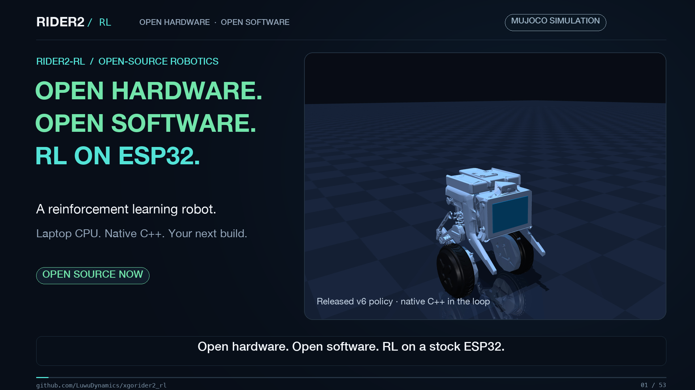

# Rider2-RL

[English](README.md) · [简体中文](README.zh-CN.md)

[](https://github.com/LuwuDynamics/xgorider2_rl/raw/refs/heads/main/media/rider2-promo-en.mp4)

**[▶ English video · 52 seconds](https://github.com/LuwuDynamics/xgorider2_rl/raw/refs/heads/main/media/rider2-promo-en.mp4)** · [中文视频 · 56 秒](https://github.com/LuwuDynamics/xgorider2_rl/raw/refs/heads/main/media/rider2-promo-zh.mp4)

**A reinforcement-learning balance controller that runs on a stock ESP32.**
A 1,796-parameter neural network, trained on a laptop CPU in MuJoCo, balances the wheel-legged robot **XGO-Rider2** on its original main board. An official open-source release by the manufacturer of the robot.

[Safety](SAFETY.md) · [Notices & provenance](NOTICE.md) · [Video files & credits](media/README.md)

## Copy to your coding agent: reproduce and train

<details>
<summary>Expand the ready-to-copy prompt for setup, simulation, and CPU training</summary>

Paste the entire prompt below into Codex, Claude Code, or another coding agent with access to your local terminal. It checks the environment, reproduces the simulation, and trains your own policy. Full training is the default; to try the shipped policy only, append: "Only reproduce the shipped policy this time; do not train a new one." The agent needs terminal access and permission to install dependencies. Initial downloads take additional time.

```text
Run the XGO-Rider2 reinforcement-learning project on my computer: set up the environment, reproduce the simulation, and train on CPU.
GitHub repository: https://github.com/LuwuDynamics/xgorider2_rl

Execute the following steps and work through issues until completion. If environment or access problems block progress, report the specific blocker and next step:
1. Reuse the current checkout if it is this project, preserving existing changes; otherwise clone the repository into a new directory. Read the root README, training/README, and SAFETY.md, then check the scripts' actual arguments. Record the Git commit, OS, CPU architecture, available memory, and dependency versions.
2. Use the native environment on macOS or Linux. On Windows, run inside WSL2 Linux and keep the checkout in its Linux filesystem, such as ~/xgorider2_rl. Check Python 3.11, Git, clang++, and the system libraries needed by MuJoCo. If WSL2 is unavailable, explain the missing prerequisites and installation steps. Training uses CPU only and does not require CUDA.
3. Keep training/ and firmware/ as siblings. Run sh setup.sh inside training/ and use the project's .venv. Recreate the virtual environment and native build cache when changing systems, keeping the exact requirements.txt pins. Resolve environment issues while preserving the training algorithm, rewards, observation contract, firmware source, and shipped weights.
4. Run the unit tests under training/tests. Copy artifacts/balance-v6/ into this experiment's directory, run verify_export2.py on that copy (it writes a verification report), and briefly evaluate its policy in stand, stand_push, and drive scenarios. If a desktop display is available, briefly open and close the simulator. Otherwise complete headless verification first and report graphics availability separately.
5. Run short training in a separate output directory with --steps 32768 --warmup-steps 4096 --envs 2 --stand-fraction 0.5 --n-steps 512 --batch-size 1024 --eval-every 16384 --eval-seeds 1 --eval-workers 2 --corner-fraction 0.5 --seed 7171. Confirm that PPO timesteps increase, actor parameters change, and export works. Then train in another new directory using the published training/README recipe: 4 million steps, 5 environments, evaluation every 500,000 steps, 8 evaluation seeds, 5 evaluation workers, corner-fraction=0.5, seed=7171. Keep all other parameters at the release recipe's defaults rather than reusing smoke-check overrides. Do not substitute a default train2.py invocation for the published recipe. If resource constraints require different parallelism, record the changes and their effect on reproducibility.
6. Average the five checkpoints from 1.5 million through 3.5 million steps as documented, export a new policy, then run verify_export2.py, native C++ policy evaluation, and loop_margin.py. Across CPUs or systems, judge numerical agreement and evaluation metrics rather than requiring trained weights to match the shipped hash.
7. Put new logs, checkpoints, and exports in timestamped directories, such as training/runs/agent-TIMESTAMP and training/artifacts/agent-TIMESTAMP. Direct shipped-policy evaluation output to a new directory too. Preserve existing experiments and artifacts/balance-v6/. This task covers simulation and training only; do not flash or operate a physical robot.
8. Report the commands actually run, environment versions, test results, training steps and elapsed time, evaluation metrics, export verification errors, and full paths to logs and weights. Distinguish completed, failed, and unexecuted steps. A short training check does not count as full training or hardware validation.
```

</details>

## Supported environments and validation

| Platform | Current status |
| --- | --- |
| **macOS** | Current primary development, training, and reproduction environment: Apple silicon, Python 3.11. The full published training recipe has run here. |
| **Linux** | **Verified to run** in Docker with Debian 12 / ARM64 / Python 3.11: dependency installation, all 24 training tests, shipped-policy verification and evaluation, short training, resume, export, and new-policy verification passed. Virtual-display viewing and offscreen rendering were also checked. |
| **Windows** | **WSL2 Linux is recommended**, using the same training commands inside Linux. WSL2 and native Windows have not yet been tested. |

The Linux check used the existing training and firmware code: 32,768 PPO steps followed by resumed training to 40,960 total steps. The full 4 million-step release recipe has not been rerun on Linux. On Windows, keep the checkout in WSL2's Linux filesystem and recreate `.venv` and native build caches there. Interactive viewing needs a working graphical display, such as WSLg. See [training environment setup](training/README.md#setup).

## Project at a glance

| | |
| --- | --- |
| Policy | 18 → 32 → 32 → 4 tanh MLP, float32, **1,796 parameters = 7,184 bytes** |
| Inference on the ESP32 | about **0.4–0.8 ms** per call (240 MHz), deadline 2 ms, one call per control tick (≈ 4–6 ms), no Python, no ONNX, no heap allocation |
| Training | PPO (Stable-Baselines3) on **CPU only**: the shipped recipe (4 M steps) takes ≈ **8–15 minutes** on an Apple M4 MacBook Air (10 cores, evaluations included) |
| Simulator | MuJoCo 3 with the **firmware's own C++ running in the loop** (IMU filter, leg controller, servo-bus decoder, policy controller) |
| Sim-to-real | the simulated wheel drive is identified from the real robot's frequency response; every randomised robot is re-fitted to that response |
| Image | `firmware.bin` 1.24 MB of the 1.5 MB app slot, **bit-for-bit reproducible** build (PlatformIO, pinned toolchain) |

## What is in this repository

```
firmware/    Build, test, flash and run.  ESP32 firmware (PlatformIO), the trained v6 weights, host tests, flasher, USB/BLE tools.
training/    Reproduce and extend the training.  MuJoCo simulator (optional CAD meshes under a non-commercial license), system identification, PPO, export, evaluation, real-robot traces.
SAFETY.md    Read before you put it on a robot.
NOTICE.md    Release and trademarks, provenance of the firmware, third-party software, data included.
```

## Quick start

### 1. Look at the policy in the simulator (2 minutes, no robot needed)

```sh
cd training
sh setup.sh                  # creates .venv: MuJoCo, PyTorch, Stable-Baselines3 (CPU)
sh run.sh view               # interactive window, the robot drawn from its CAD meshes, W/A/S/D drive; add --pushes for random shoves
sh run.sh verify             # exported weights == native C++ float32 inference
sh run.sh evaluate --seeds 8 # survival / jitter / tracking on the identified, randomised plant
```

### 2. Train it yourself (≈ 10 minutes on a recent laptop)

```sh
cd training
.venv/bin/python train2.py --output runs/mine --envs 5 --steps 4000000 --eval-every 500000 --eval-seeds 8 --eval-workers 5 --corner-fraction 0.5 --seed 7171
```

Then average checkpoints, export, verify, evaluate and copy the weights into the firmware — the exact commands are in [training/README.md](training/README.md).

### 3. Build the firmware (and test it on the host)

```sh
cd firmware
python3 tools/run_host_tests.py      # 25 test groups, -Wall -Wextra -Werror, key C++ tests under ASan/UBSan
sh build.sh                          # -> dist/firmware.bin + dist/manifest.json
```

### 4. Put it on a robot (read [SAFETY.md](SAFETY.md) first)

Back up the stock firmware, then use the flasher. It reads only the partition table and OTA metadata, refuses anything that does not match a stock XGO-Rider2, and writes **only** the app slot that the bootloader currently selects. See [firmware/README.md](firmware/README.md).

## How it works (one page)

```
real robot trace ──► sysid_frf.py ──► measured frequency response (command → pitch rate, wheel speed)
                                            │
          plant.py  samples wheel drives / sensors that reproduce that response; masses, CoM, friction, noise are randomised
                                            │
          env2.py   MuJoCo + the firmware C++ in the loop (IMU filter, legs, bus, policy controller)
                                            │
   design_linear.py ──► robust linear controller (delay-aware, stress-tested) ──► cloned into the 18-32-32-4 network
                                            │
          train2.py ──► critic warm-up ──► PPO with corner sampling and jitter penalties ──► checkpoint averaging
                                            │
 export_actor2.py / verify_export2.py ──► policy_weights.h (float32) ──► native C++ == reference
                                            │
   loop_margin.py + evaluate2.py ──► stability margins on the REAL response + survival / jitter / tracking suite
                                            │
          firmware/ ──► host tests ──► PlatformIO build ──► flash_app.py ──► guards on the robot (tilt, lift, free fall)
```

The design decisions and the evidence behind them are written up in [training/docs/PIPELINE.md](training/docs/PIPELINE.md).

## Results (honest summary)

Simulation, native C++ controller, 32 seeds × 20 s, identified and randomised plant (`training/artifacts/balance-v6/RESULTS.md`):

| Scenario | Survived |
| --- | --- |
| Standing | 32 / 32 |
| Standing + random pushes | 32 / 32 |
| Random drive commands + random pushes | 32 / 32 |
| 5× sensor noise | 32 / 32 |
| Motor gain × 1.8 / 12 ms extra delay / 18 ms lag / weak motors | 32 / 32 each |
| 2.5× pushes + large initial tilt | 31 / 32 |
| Wheel-speed scale 0.4 (outside the training range) | 25 / 32 |
| All random parameters at their extremes ("corners") | **23 / 32** (the weakest area) |

On the real robot (maintainer's measurements, October 2026, three XGO-Rider2 units; raw logs are not published): the 7–14 Hz ringing of the previous policy disappeared — wheel-command energy above 3 Hz fell to 1–2 % of the total (rms 5–8 vs 150–260 before), pitch-rate standard deviation 16–24 °/s (before: 70–150 °/s); hands-off standing for 20 s kept the wheel speed ≤ 7; phone remote control and light/hard pushes behaved normally.
Stability margin on the measured frequency response: sensitivity peak **1.83** (previous policy: 22.1), loop gain above 8 Hz **0.40** (previous: 1.49).

What RL contributes is stated in the training notes without spin: a cloned linear core is already stable; PPO + weight averaging improved the corner survival from 11/24 to 19/24 and the hard-push survival from 19/24 to 22/24 on a 24-seed comparison, at the price of slightly slower speed tracking.

## Hardware and compatibility

* XGO-Rider2 with its ESP32 main board (ESP32-D0WD, 4 MB flash, **stock partition table required**). Wheels: servo IDs 11/21; legs (vertical slides, 36 mm travel): IDs 12/22.
* The Raspberry Pi compute module on the robot is not used by this firmware.
* The firmware keeps the stock BLE/UART binary protocol and the stock flash locations of the leg zero points, BLE name and pitch trim, so the phone app and the stock calibration keep working.
* Legs are not trained in this release (their two policy outputs are fixed at zero); the legs are position-controlled and level the body.

## Status and limitations

* Hardware validation was done by the maintainer on three units; this is **not** a certification and the controller can fall. Do not use it near people, stairs or water.
* Corner-case survival in simulation is 72 %; the free-fall guard cannot protect drops below ≈ 20 cm; the BLE interface has **no authentication** (as in the stock firmware). Details in [SAFETY.md](SAFETY.md).
* Training and simulation are currently developed on macOS; the training workflow passed a short Linux Docker check. WSL2 is recommended for Windows. See "Supported environments and validation" above for the exact scope.

## License

Licensed under the [Apache License 2.0](LICENSE): the firmware, the training code and the trained weights.

**Exception: `training/models/cad/`** — the robot's CAD display meshes and the files derived from them — is licensed under [CC BY-NC 4.0](training/models/cad/LICENSE): **non-commercial use only**. It is included just to make simulation and training convenient and is optional: everything runs without it except the fall / get-up probes.

Third-party software is not redistributed here and keeps its own licenses ([NOTICE.md](NOTICE.md)). Neither license grants any right to the names "XGO" and "XGO-Rider2".

The [project videos](media/README.md) retain the CAD visual and third-party audio licenses listed in their credits.
