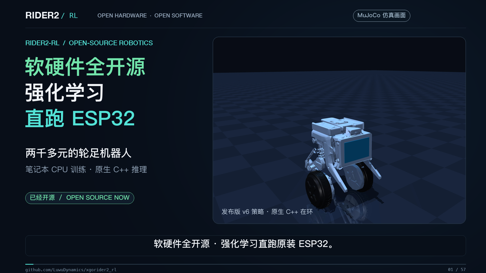

# Rider2-RL

[简体中文](README.zh-CN.md) · [English](README.md)

[](https://github.com/LuwuDynamics/xgorider2_rl/raw/refs/heads/main/media/rider2-promo-zh.mp4)

**[▶ 中文视频 · 56 秒](https://github.com/LuwuDynamics/xgorider2_rl/raw/refs/heads/main/media/rider2-promo-zh.mp4)** · [English video · 52 seconds](https://github.com/LuwuDynamics/xgorider2_rl/raw/refs/heads/main/media/rider2-promo-en.mp4)

**在原装 ESP32 上运行的强化学习平衡控制器。**
一个只有 1,796 个参数的神经网络，在笔记本 CPU 上用 MuJoCo 训练，让轮足机器人 **XGO-Rider2** 在它自己的主控板上站稳、听遥控、被推不倒。XGO-Rider2 厂家官方发布的开源项目。

[安全须知](SAFETY.md) · [声明与来源](NOTICE.md) · [视频文件与素材署名](media/README.md)

## 复制给智能体：复现与训练

<details>
<summary>点击展开：可直接复制的环境配置、仿真复现与 CPU 训练提示词</summary>

把下面整段提示词复制到 Codex、Claude Code 等能操作本地终端的编程智能体中，即可让它检查环境、复现仿真并训练自己的策略。默认执行完整训练；只想体验已有模型时，在末尾追加「本次只复现已有模型，不重新训练」。需要本地终端和安装依赖的权限，首次下载依赖的时间另计。

```text
请在我的电脑上实际运行 XGO-Rider2 的强化学习项目，完成环境配置、仿真复现和 CPU 训练。
GitHub 仓库：https://github.com/LuwuDynamics/xgorider2_rl

请按以下顺序执行，并持续处理问题直到完成；遇到无法自行解决的环境或访问问题时，报告具体阻塞和下一步：
1. 如果当前目录已是此项目，直接使用并保留已有改动；否则将上述仓库克隆到新目录。先阅读仓库 README、training/README 和 SAFETY.md，再核对脚本的实际参数。记录 Git 提交、操作系统、CPU 架构、可用内存和依赖版本。
2. macOS 或 Linux 使用本机环境；Windows 使用 WSL2 内的 Linux，并将仓库放在 Linux 文件系统（如 ~/xgorider2_rl）。检查 Python 3.11、Git、clang++ 和运行 MuJoCo 所需的系统库。WSL2 未就绪时，先给出缺少的前提和安装步骤。训练只用 CPU，无需 CUDA。
3. 保持 training/ 与 firmware/ 同级，在 training/ 中执行 sh setup.sh，使用项目自己的 .venv。跨系统时重新创建虚拟环境和本地编译缓存，保留 requirements.txt 的固定版本。优先解决环境问题，保持训练算法、奖励、观测协议、固件源码和随仓库发布的权重不变。
4. 运行 training/tests 下的单元测试；将 artifacts/balance-v6/ 复制到本次实验目录，对副本运行 verify_export2.py（它会写入验证报告），再对其中策略做一次 stand、stand_push、drive 的短评估。有桌面显示时限时打开仿真窗口并退出；无显示环境先完成无窗口验证，单独说明图形显示状态。
5. 先在独立输出目录短程训练，使用 --steps 32768 --warmup-steps 4096 --envs 2 --stand-fraction 0.5 --n-steps 512 --batch-size 1024 --eval-every 16384 --eval-seeds 1 --eval-workers 2 --corner-fraction 0.5 --seed 7171，确认 PPO 步数增加、策略参数发生更新，并验证导出能跑通。随后在另一个新目录按 training/README 的发布配方正式训练：400 万步、5 个环境、每 50 万步评估、8 个评估种子、5 个评估进程、corner-fraction=0.5、seed=7171；其余参数保留发布配方的默认值，不沿用短测参数。不要用 train2.py 的默认命令替代发布配方。若资源限制确需调整并行度，记录调整及其对复现的影响。
6. 按文档平均 150 万至 350 万步的五个检查点，再导出新策略，运行 verify_export2.py、原生 C++ 策略评估及 loop_margin.py。跨 CPU/系统以数值一致性和评估指标判断结果，不要求训练后的权重哈希与发布版本相同。
7. 所有新日志、检查点和导出文件使用带时间戳的新目录，例如 training/runs/agent-时间戳 和 training/artifacts/agent-时间戳；发布策略评估时也将输出指定到新目录。保留已有实验和 artifacts/balance-v6/。本次只运行仿真与训练，不刷机或驱动真实机器人。
8. 最后汇报实际执行的命令、环境版本、测试结果、训练步数与耗时、评估指标、导出验证误差，以及日志和权重的完整路径。清楚区分已完成、失败和未执行的步骤；短程训练通过不等于正式训练完成，也不等于实机验证通过。
```

</details>

## 运行平台

| 平台 | 当前状态 |
| --- | --- |
| **macOS** | 当前主要开发、训练和复现环境：Apple 芯片、Python 3.11；完整发布训练配方已在此运行。 |
| **Linux** | **已验证可以运行**：Debian 12 / ARM64 / Python 3.11 的 Docker 环境，安装依赖、24 个训练测试、发布策略验证与评估、短程训练、续训、导出及新策略验证均通过；也验证了虚拟显示和离屏渲染。 |
| **Windows** | **建议通过 WSL2 运行 Linux 环境**，在其中安装依赖并执行同一套训练命令。WSL2 和原生 Windows 尚未实测。 |

Linux 验证使用原有训练和固件代码，完成 32,768 步 PPO 训练及续训至累计 40,960 步；尚未在 Linux 上复跑完整 400 万步发布配方。Windows 用户将代码放在 WSL2 的 Linux 文件系统内，并重新创建 `.venv` 与编译缓存；交互窗口需要可用的图形显示环境（如 WSLg）。详见 [训练环境说明](training/README.zh-CN.md#环境)。

## 项目特点

| | |
| --- | --- |
| 策略 | 18 → 32 → 32 → 4 的 tanh MLP，float32，**1,796 个参数 = 7,184 字节** |
| ESP32 推理 | 每次约 **0.4–0.8 ms**（240 MHz），截止时间 2 ms，每个控制周期（约 4–6 ms）推理一次；没有 Python、没有 ONNX、没有动态内存分配 |
| 训练 | PPO（Stable-Baselines3），**只用 CPU**：发布的配方（400 万步）在 Apple M4 MacBook Air（10 核，含评估）上约 **8–15 分钟** |
| 仿真 | MuJoCo 3，**固件自己的 C++ 在仿真环里运行**（IMU 滤波、腿控制器、舵机总线解码、策略控制器） |
| 仿真到实机 | 仿真里的轮驱用实机的频率响应辨识；每个随机出来的机器人都按这条响应重新拟合 |
| 固件镜像 | `firmware.bin` 1.24 MB（应用槽 1.5 MB），**逐位可复现**的构建（PlatformIO，固定工具链） |

## 仓库里有什么

```
firmware/    构建、测试、烧录、运行。ESP32 固件（PlatformIO）、训练好的 v6 权重、主机测试、烧录器、USB/BLE 工具。
training/    复现并继续训练。MuJoCo 仿真（可选的 CAD 网格仅限非商业使用）、系统辨识、PPO、导出、评估、实机 trace。
SAFETY.md    上机之前先读。
NOTICE.md    发布说明与商标、固件来源、第三方软件、随仓库发布的数据。
```

## 快速开始

### 1. 先在仿真里看看（2 分钟，不需要机器人）

```sh
cd training
sh setup.sh                  # 创建 .venv：MuJoCo、PyTorch、Stable-Baselines3（CPU 版）
sh run.sh view               # 交互窗口（机器人按 CAD 网格绘制），W/A/S/D 遥控；加 --pushes 随机推它
sh run.sh verify             # 导出的权重 == 原生 C++ float32 推理
sh run.sh evaluate --seeds 8 # 在辨识过的随机化仿真里测存活 / 抖动 / 跟踪
```

### 2. 自己训练（新一点的笔记本上约 10 分钟）

```sh
cd training
.venv/bin/python train2.py --output runs/mine --envs 5 --steps 4000000 --eval-every 500000 --eval-seeds 8 --eval-workers 5 --corner-fraction 0.5 --seed 7171
```

之后做检查点平均、导出、验证、评估，再把权重放进固件——完整命令见 [training/README.zh-CN.md](training/README.zh-CN.md)。

### 3. 构建固件（先在主机上测）

```sh
cd firmware
python3 tools/run_host_tests.py      # 25 组测试，-Wall -Wextra -Werror，关键 C++ 测试带 ASan/UBSan
sh build.sh                          # -> dist/firmware.bin + dist/manifest.json
```

### 4. 烧到机器人上（先读 [SAFETY.md](SAFETY.md)）

先备份原厂固件，再用烧录器。它只读分区表和 OTA 元数据，只要不是原厂 XGO-Rider2 的布局就拒绝写入，并且**只写**引导程序当前选中的那个应用槽。见 [firmware/README.zh-CN.md](firmware/README.zh-CN.md)。

## 原理（一页）

```
实机 trace ──► sysid_frf.py ──► 实测频响（命令 → 俯仰角速度、轮速）
                                      │
       plant.py  采样出复现该频响的轮驱/传感器；质量、重心、摩擦、噪声另外随机化
                                      │
       env2.py   MuJoCo + 固件 C++ 在环（IMU 滤波、腿、总线、策略控制器）
                                      │
 design_linear.py ──► 带延迟、做过压力测试的鲁棒线性核 ──► 克隆进 18-32-32-4 网络
                                      │
       train2.py ──► critic 预热 ──► PPO（角点采样 + 抖动惩罚）──► 检查点权重平均
                                      │
 export_actor2.py / verify_export2.py ──► policy_weights.h（float32）──► 原生 C++ == 参考实现
                                      │
 loop_margin.py + evaluate2.py ──► 用实机频响算稳定裕度 + 存活/抖动/跟踪验收
                                      │
       firmware/ ──► 主机测试 ──► PlatformIO 构建 ──► flash_app.py ──► 机器人上的保护（倾倒、拿起、自由落体）
```

每个设计决定和对应的证据写在 [training/docs/PIPELINE.zh-CN.md](training/docs/PIPELINE.zh-CN.md)（中文）和 [training/docs/PIPELINE.md](training/docs/PIPELINE.md)（English）。

## 结果（如实）

仿真，原生 C++ 控制器，32 个种子 × 20 s，辨识并随机化的仿真（`training/artifacts/balance-v6/RESULTS.md`）：

| 场景 | 存活 |
| --- | --- |
| 站立 | 32 / 32 |
| 站立 + 随机推 | 32 / 32 |
| 随机遥控指令 + 随机推 | 32 / 32 |
| 5 倍传感器噪声 | 32 / 32 |
| 电机增益 ×1.8 / 额外延迟 12 ms / 滞后 18 ms / 弱电机 | 各 32 / 32 |
| 2.5 倍推力 + 大初始倾角 | 31 / 32 |
| 轮速比例 0.4（超出训练范围） | 25 / 32 |
| 所有随机参数同时取极端值（“角点”） | **23 / 32**（最弱的地方） |

实机（作者的测量，2026 年 10 月，三台 XGO-Rider2；原始日志不公开）：上一版策略的 7–14 Hz 共振消失了——3 Hz 以上的轮指令能量降到总量的 1–2 %（均方根 5–8，之前 150–260），俯仰角速度标准差 16–24 °/s（之前 70–150 °/s）；地上手松开站 20 秒轮速不超过 7；手机遥控、轻推、用力推都正常。
实测频响上的稳定裕度：灵敏度峰值 **1.83**（上一版 22.1），8 Hz 以上环路增益 **0.40**（上一版 1.49）。

RL 到底贡献了什么，训练笔记里不夸大：把线性核克隆进网络，本身就已经稳；PPO + 权重平均在 24 个种子上把角点存活从 11/24 提高到 19/24，大推力从 19/24 提高到 22/24，代价是速度跟踪稍慢。

## 硬件与兼容性

* XGO-Rider2 及其 ESP32 主控板（ESP32-D0WD，4 MB flash，**必须是原厂分区表**）。轮子：舵机 ID 11/21；腿（垂直滑杆，行程 36 mm）：ID 12/22。
* 机器人上的树莓派计算模块本固件不使用。
* 固件保留原厂 BLE/UART 二进制协议，以及腿零点、BLE 名称、俯仰修正在 flash 里的原厂位置，所以手机 App 和原厂标定照常可用。
* 本版没有训练腿（策略的两路腿输出固定为 0）；腿由位置控制器控制并做侧倾调平。

## 状态与局限

* 硬件验证是作者在三台机器上做的，**不是**认证，控制器会摔倒。不要在有人、楼梯、水的地方用。
* 仿真角点存活 72 %；自由落体卸力在大约 15–20 cm 以下的跌落来不及；BLE 接口**没有认证**（和原厂固件一样）。详见 [SAFETY.md](SAFETY.md)。
* 训练和仿真当前在 macOS 上开发；Linux Docker 已通过训练流程短测；Windows 建议使用 WSL2。具体环境与验证范围见上方「运行平台」。

## 许可证

采用 [Apache License 2.0](LICENSE)：固件、训练代码和训练好的权重。

**例外：`training/models/cad/`**（机器人的 CAD 显示网格及由它派生的文件）采用 [CC BY-NC 4.0](training/models/cad/LICENSE)，**仅限非商业使用**。放它只是为了方便大家仿真和训练，它是可选的：没有它，除摔倒/起身探针外都能运行。

第三方软件不随本仓库分发，保留各自的许可证（见 [NOTICE.md](NOTICE.md)）。两种许可证都不授予“XGO”“XGO-Rider2”这些名称的任何权利。

[项目视频](media/README.md) 保留 CAD 画面和第三方声音素材的许可，详见视频署名说明。
