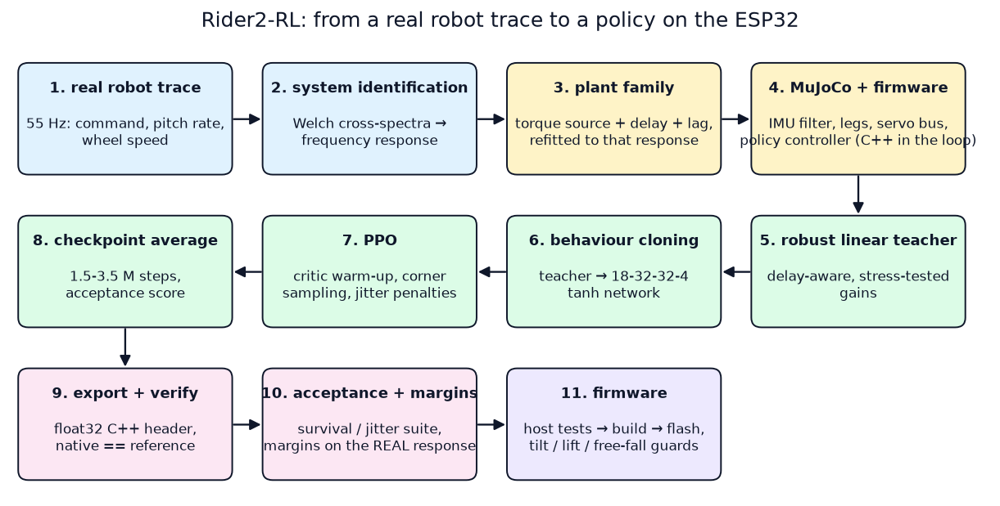
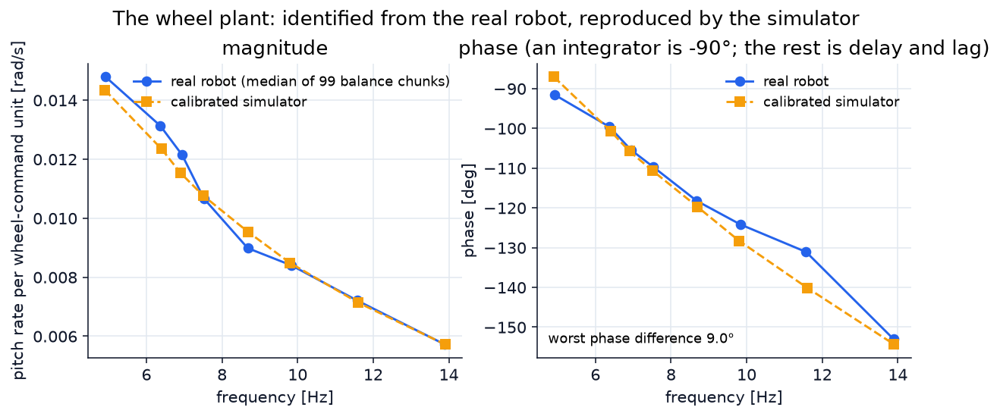
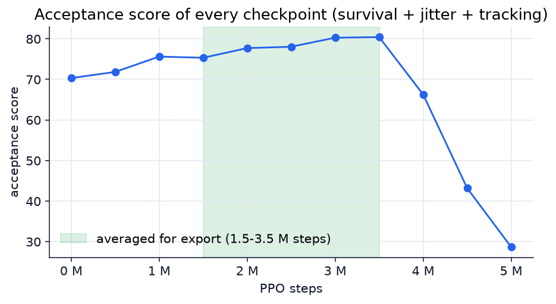
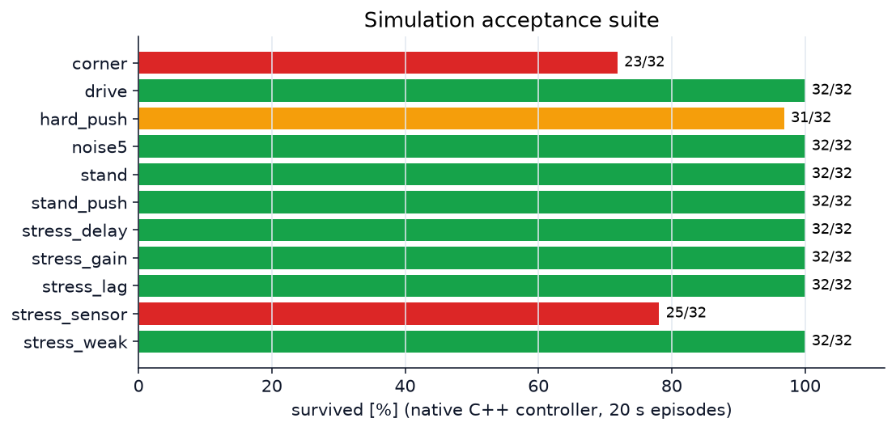
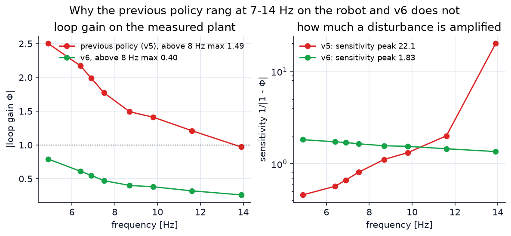

# 训练流程，一步一步

一个策略怎样从实机 trace 走到 ESP32、每一步为什么存在、证据是什么。命令在 [../README.zh-CN.md](../README.zh-CN.md)；完整的工程日志是 [REBUILD.zh-CN.md](REBUILD.zh-CN.md)。[English](PIPELINE.md)



## 0. 为什么流程是这个样子：第一次在实机上失败了

第一版流程把轮驱仿真成一个假设的*速度伺服*，用无延迟的 LQR 初始化网络，跑 PPO，只要不倒就验收。仿真里 80 次全过。上了实机，它**一直在 7–14 Hz 共振**。这不是调参的问题，是流程的问题：

| 发现 | 证据 |
| --- | --- |
| 真实的轮子像力矩源加约 13 ms 的延迟和滞后，不是速度伺服 | 实测命令→俯仰角速度相位 −92°（4.8 Hz）…−153°（13.5 Hz）；旧仿真同频段只有 −47°…−103°（少滞后 30–45°） |
| 仿真里的轮速信号大约大 3 倍 | 实测轮速/俯仰角速度 ≈ 0.83；自由滚动的双轮应该是 2.6；旧仿真 3.0–4.3 |
| 旧策略在**实机**响应上几乎没有稳定裕度 | 把它的局部增益代入实测响应：灵敏度峰值 **22**（v5）、**12.9**（v8）；8 Hz 以上环路增益 1.49（> 1） |
| 它把上一拍命令反馈回去（高频放大器）、每 12 ms 才更新一次（平均多 6 ms 保持）、偏航增益（130–144）贴着那个回路的稳定边界（≈ 120 以内稳定，250 自激） | 策略输入 13/14、`kPeriodUs`、偏航增益分析 |
| 验收不看抖动 | 只统计倒地和跟踪误差 |
| 之后在实机上做的 A/B（限速、平滑、缩放增益）都是治标 | 给一个高频本来就临界的环路再加滞后，只会更糟 |

由此得到贯穿下面所有步骤的教训：**仿真里不倒，对实机什么也说明不了，除非仿真的对象是在实机上测出来的，而且验收必须包括抖动和稳定裕度。**

## 1. 从机器人自己的振荡里辨识轮驱（`tools/sysid_frf.py`）

机器人平衡时一直在振荡。这个振荡是窄带信号，轮命令和机体响应之间的相干性≈ 1，所以闭环数据不需要任何特殊激励，就能在振荡频率上辨识对象。对每一段约 4 秒的平衡数据，工具在主要命令频率 f* 上用 Welch 互谱拟合 `H(f*) = S_uy / S_uu`，分别针对

* 固件俯仰角速度 / 每单位共同轮命令，
* 平均轮速（舵机总线读到的）/ 每单位共同轮命令，

再按频率分箱取中位数 → `models/measured_frf.json`（99 段，8 个箱，4.9–13.9 Hz，来自 `data/real_robot_traces/`）。



结果：增益从 0.0148 降到 0.0057 rad/s 每命令单位，相位从 −92° 到 −153°——一个积分器（−90°）加上约 13 ms 的命令延迟和力矩滞后。总线上看到的轮速只有俯仰角速度的约 0.83 倍，自由滚动的双轮不可能这样；解释是**速度寄存器读到的只有真实轮缘速度的约 0.28 倍**。后来手推机器人走 0.9 m 的台架核对确认是 0.275（编码器距离 0.878 m，速度寄存器积分只有 0.242 m）。

## 2. 实机打不脸的仿真器（`rider_sim/plant.py`、`env2.py`）

* **模型**（`models/rider_measured.xml`）：自由漂浮的底盘，实测总质量 578 g（含电池和计算模块），轮胎直径 61.6 mm，轮距 86.6 mm，腿是两个等效的滑动关节，用固件的 45–81 mm 运动学。没有平衡弹簧或隐藏的稳定器：一个单元测试检查“轮动作为零就会倒”。
* **轮驱**：力矩源，命令死时（名义 2 ms）、一阶力矩滞后（名义 7.2 ms）、IMU 通路再加 2.5 ms，速度传感器读数是真实速度的 0.28 倍。
* **每个回合随机化**：轮子阻尼和电枢惯量、死时（约 1–7 ms）、滞后（−40 … +60 %）、IMU 延迟、库仑摩擦、额外重心偏移（−4 … +14 mm）、速度传感器比例（0.28 ± 30 %）、各部件质量和惯量（在实测总质量内）、地面摩擦 0.55–1.15 和倾斜、IMU 与轮反馈噪声、控制/反馈时隙（控制周期 4、6 或 8 ms）、推搡（0.1–0.8 N，80 ms，每 1–3 s 一次）和初始俯仰/横滚/航向。
* **关键的一招**：其它参数都抽完之后，**轮的力矩常数和传感器比例是反推出来的，让这个具体抽样出来的机器人仍然复现实测频响**，再按数据里看到的运行间离散度打散（−25 … +35 %）。没有哪个样本会比真机更好控。`tools/sim_frf_check.py` 用数据验证校准后的仿真：幅值比 0.92–1.09，相位最差差 9.2°（旧仿真：45° 的相位差、3 倍的轮速信号）。
* **固件 C++ 在环里运行。** `native/*.cpp` 把 `../firmware/src`——IMU 融合、腿位置控制器、舵机总线帧解码（整数速度量化、轮方向、编码器回绕）和策略控制器（观测、推理、限速、积分）——编译成动态库，MuJoCo 通过 ctypes 驱动它们。没有任何东西在 Python 里重写。物理传感器的值经过安装变换、量化和噪声，才交给固件自己的字节解码。仿真的微秒时间与宿主机调度无关，所以笔记本忙起来不会被当成 MCU 超时。

## 3. 教师：鲁棒线性核（`tools/design_linear.py`）

共同轮命令上的静态增益 `u = kp·俯仰 + kd·俯仰角速度 + kv·轮速 + kx·位置 + ki·∫位置`，在**带延迟的、辨识出来的**名义对象上最小化噪声驱动的 LQ 代价，**并且要求在压力对象上稳定**：2 倍力矩常数、+10 ms 延迟、2 倍滞后、轮速传感器 0.25 … 1 倍、0.6 倍力矩常数，且阻尼比有下限。随机起点加 Nelder–Mead。它既用来初始化网络，也是判断学习部分到底加了什么的参照。它不是旧的无延迟 LQR；第一次尝试就是因为那个，在振荡频率上环路增益大于 1。

## 4. 行为克隆 → critic 预热 → PPO（`train2.py`）

* **网络**：`MlpPolicy`，actor 18 → 32 → 32 → 4，tanh（导出的就是这部分），critic 64 → 64（只在训练里用）。轮子是输出 0–1；腿的输出 2–3 在本版里固定为 0。
* **行为克隆**：在随机化机器人上带 0.01–0.08 的探索噪声采集约 24 万个教师样本，30 个 epoch（最终 MSE 3.4e-6）。克隆出来的网络*就是*教师，先评估，PPO 只有赢过它才保留。
* **critic 预热**：actor 冻结 30 万步，价值函数从同策略数据里学习。
* **PPO**：5 个并行环境（一个只站立，四个带随机遥控指令和推搡），每次 rollout 512 步 × 5，batch 2048，5 个 epoch，γ 0.997，λ 0.95，clip 0.1，学习率 4e-5，目标 KL 0.015，没有熵奖励，轮子初始探索 σ 0.03。
* **角点采样**：一半的回合里，每个随机对象参数都放在区间的一端。裕度薄的控制器就是在这些情形失败的，所以训练必须经常见到它们。
* **奖励**：`1 + exp(-((俯仰 − 平衡点)/0.2)²) + exp(-(速度误差/0.12)²) + 2·exp(-(偏航误差/0.08)²) + 1.2·exp(-(位置误差/0.08)²) − 0.25·min((位置误差/0.15)², 100)`，再减去对命令（`0.05·|a|²`）、命令变化率（`6·|Δa|²`）和二阶差分（`3·|Δ²a|²`）、横滚、机体角速度的惩罚；倒地 −50。变化率/二阶差分/机体角速度的惩罚，就是让输出不发抖的东西。

## 5. 按验收分选，然后平均（`evaluate2.py`、`tools/average_checkpoints.py`）

每 50 万步，检查点在六个场景 × 8 个种子上跑（站立+推、遥控行驶、+12 ms 延迟、弱电机、角点、大推力），打分

```
分数 = 100·存活率 − 0.8·中位(hf_rms) − 0.3·中位(俯仰角速度 σ) − 60·中位(速度误差) − 10·中位(末位置误差)
```

（`hf_rms` = 共同轮命令 3 Hz 以上的均方根，手感上的“抖”。）



分数在 350 万步附近见顶，**之后塌掉**（原始训练里 400 万步 66、450 万步 43、500 万步 29），所以最好的单个检查点不是发布的那个。导出的权重是 **150、200、250、300、350 万步检查点的平均**，在验收套件里比任何单个都稳。

## 6. 导出和验证（`export_actor2.py`、`verify_export2.py`）

* 权重变成 float32 的 C++ 头文件（输出优先，torch 布局），带固定的输入归一化、动作比例（1023）、偏航积分配置（增益/限幅 0.08）和元数据（名称、模型 id、contract 6、sha256）。
* 网络必须忽略的六个输入（腿编码器、上一拍命令、时间间隔）在**第一层里清零**，所以即使固件仍然提供它们，导出的网络在数学上也与它们无关；两路腿输出行为零。
* 对将要在 ESP32 上运行的那份 C++ 做验证：随机输入最大动作误差 2.6e-7；15,000 个闭环样本观测误差 ≤ 7.5e-6；位置积分、偏航积分和逐 tick 的限速逐 tick 一致（`artifacts/balance-v6/native_verification.json`）。

## 7. 验收或否决：存活、抖动，以及实测响应上的裕度



原生 C++ 控制器，32 个种子 × 20 s，校准后随机化的对象：站立 32/32，站立+推 32/32，随机遥控+推 32/32，5 倍传感器噪声 32/32，电机增益 ×1.8 / +12 ms 延迟 / 18 ms 滞后 / 弱电机各 32/32，2.5 倍推力加大初始倾角 31/32；最弱的是“角点”（所有随机参数取极端）23/32 和轮速比例 0.4（超出训练范围）25/32。



更能说明问题的是用**实测**频响做的检查（`tools/loop_margin.py`）：把网络的局部增益闭在真实数据上，不涉及任何仿真器。v6 的灵敏度峰值 **1.83**，上一版 **22.1**；8 Hz 以上环路增益 **0.40**，上一版 1.49。模型一侧：名义阻尼比 0.55，增益裕度 ×3.6 上 / ×0.51 下，延迟裕度 58 ms。

**RL 到底贡献了什么，如实说。** 克隆出来的线性核本身就已经稳。在同样的 24 个种子上，它在角点场景存活 11/24、大推力场景 19/24；PPO 加权重平均之后是 19/24 和 22/24，随机指令场景的俯仰角速度更小（12 对 15 °/s），速度跟踪稍慢（0.058 对 0.048 m/s）。不用教师、从零开始的 PPO 在这个仿真里也学会了平衡，但收敛到**高增益**解（俯仰 4200、轮速 10250、位置 3540）：在实测响应上灵敏度峰值 2.5，延迟裕度只有 16 ms，命令抖动是 v6 的 2–3 倍——所以没有选它。第一次流程就是这样出的问题：只看仿真存活，会选出高增益策略。

## 8. 在机器人上

`firmware/` 运行同一个策略控制器，见 [../../firmware/docs/ARCHITECTURE.md](../../firmware/docs/ARCHITECTURE.md)。作者的测量，2026 年 10 月，三台 XGO-Rider2：7–14 Hz 的共振没有了（3 Hz 以上的轮命令能量占总量 1–2 %，均方根 5–8，之前 150–260；俯仰角速度 σ 16–24 °/s，之前 70–150 °/s）；地上手松开站 20 秒轮速不超过 7；手机遥控和推搡都正常。硬件发现了三件仿真里没有的事，每一件都变成了固件功能：轮子在空中 0.2 秒内飞转（拿起保护）、舵机在收到第一条腿命令时不应答（所有舵机重新应答后自动重新起立）、轮子有大约 20–45 个命令单位的死区，让站着的机器人前后踱步（死区预加载，只在安静站着时学习）。从桌上摔下来的经历促成了自由落体卸力。

## 9. 局限

* 仿真里没有静摩擦、齿轮间隙和软地面；轮子阻抗和总线延迟只靠随机化覆盖。腿没有训练（输出固定为 0）。
* “角点”场景存活率 72 %：所有参数同时取极端时，策略最弱。
* 仿真分数不是硬件验证。上面的硬件结果来自三台机器，不是认证。
